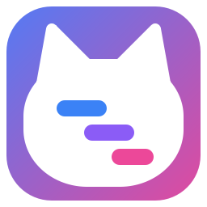
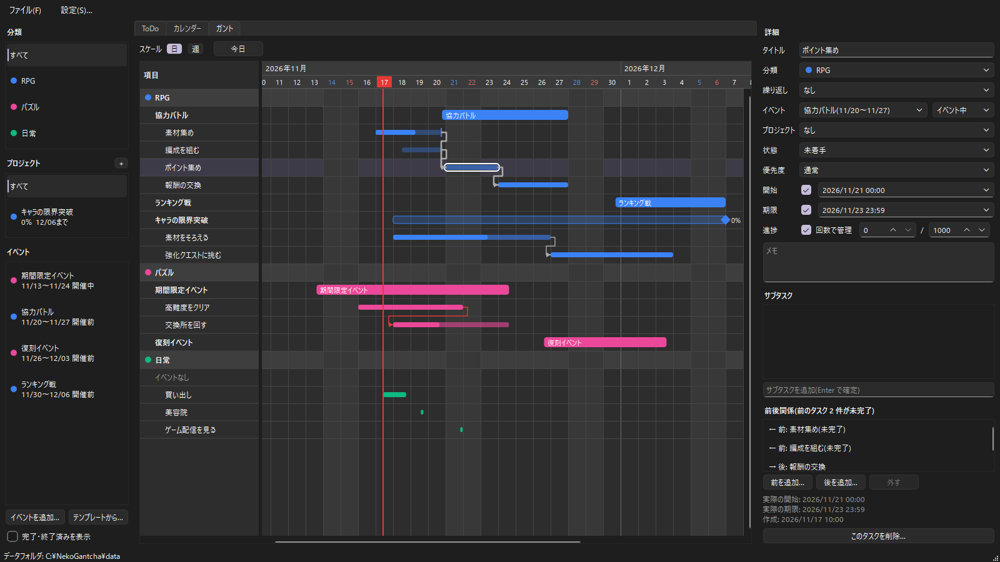
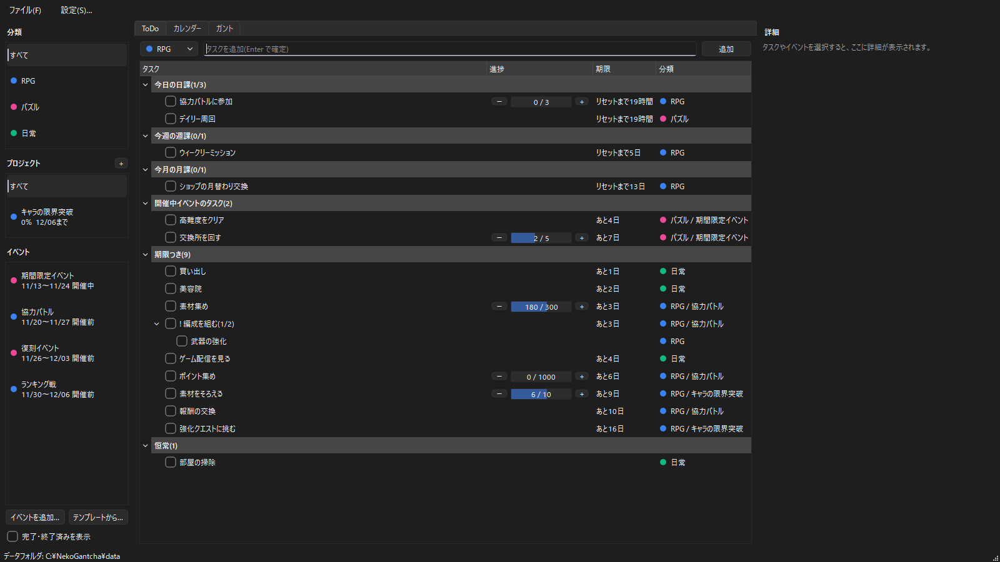
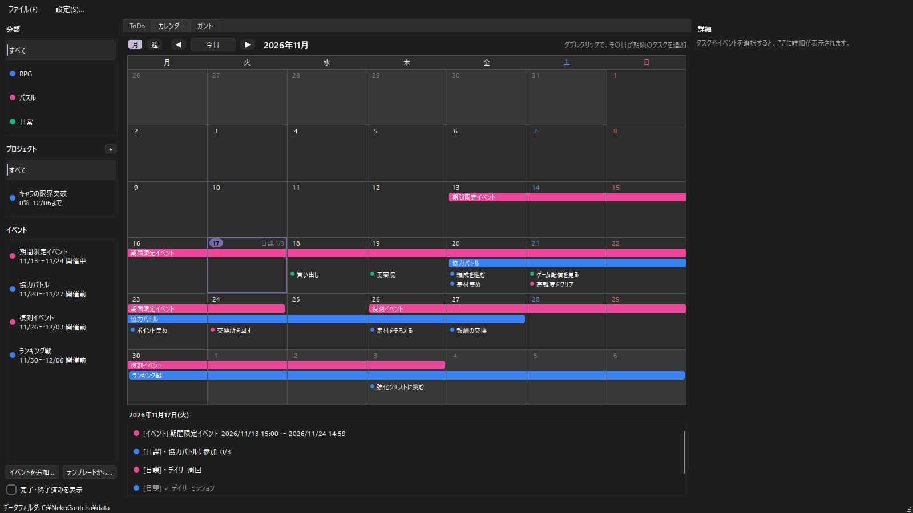
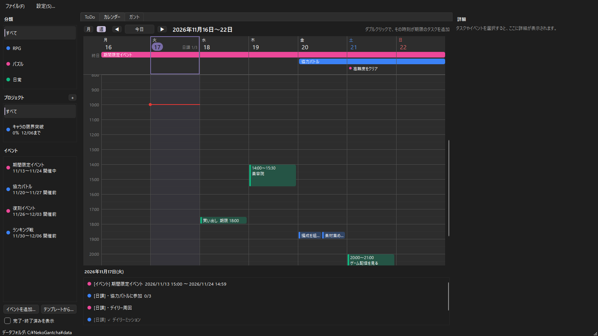
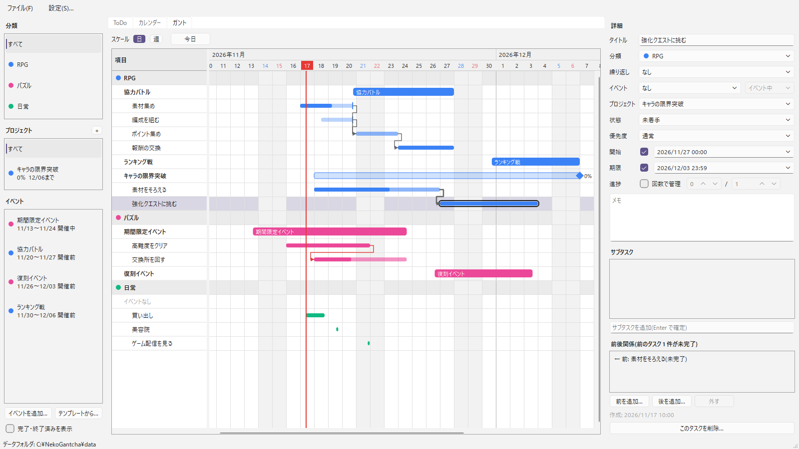

<p align="center">
  
</p>

<h1 align="center">ねこがんちゃ(NekoGantcha)</h1>

<p align="center">
  ソシャゲのイベントと日課を、ToDo・カレンダー・ガントチャートの3画面で管理する Windows デスクトップアプリ
</p>

<p align="center">
  
  
  
  
</p>



複数のソシャゲを遊んでいると、イベントの期間、イベント前の準備、毎日・毎週・毎月リセットされる日課が入り混じって、何から手をつけるべきか分からなくなりがちです。ねこがんちゃは、それらをひとつのアプリにまとめ、「今やること」「いつまでにやること」「全体の流れ」を3つの画面で見渡せるようにします。

インターネットに接続せずに動き、データはすべて手元のフォルダに保存します。アカウント登録も不要です。

## 特徴

- **3つの画面が連動**
  - **ToDo**: 今日の日課・今週の週課・今月の月課、開催中のイベントのタスク、期限つきのタスクを、セクションに分けて期限の順に並べます。
  - **カレンダー**: 月表示と週表示。イベントは期間の帯で、時刻つきの予定は時間軸に表示します。
  - **ガントチャート**: イベントとタスクを帯で並べ、ドラッグで日程を動かせます。

  どの画面で項目を選んでも、ほかの画面と右側の詳細パネルで同じ項目が選ばれます。
- **日課・週課・月課の自動リセット**: ゲームごとにリセット時刻(例: 毎日 5:00、毎週月曜、毎月1日)を設定でき、時刻をまたぐと自動で未達成に戻ります。「1日3回」のような回数つきの日課も数えられます。
- **イベントとその準備**: イベント期間中に終えるタスクと、開始までに終える準備のタスクを分けて管理できます。毎回同じ構成のイベントは、タスクごと日付をずらして複製したり、テンプレートとして保存したりできます。
- **プロジェクトとサブタスク**: 目標に向けたタスクをプロジェクトにまとめて進み具合を表示します。サブタスクは何階層でも作れます。
- **タスクの前後関係**: 「Aが終わってからB」という関係を登録すると、ガントチャートに矢印で描かれます。予定が食い違っていると赤く表示します。
- **ライト / ダーク**: Windows の設定に合わせるほか、設定画面でライトかダークに固定できます。
- **週の始まり**: カレンダーとガントチャートの週を、月曜始まりか日曜始まりにできます(設定画面)。
- **持ち運べるデータ**: データは exe と同じフォルダの `data\` に保存し、レジストリなどには書き込みません。起動時の自動バックアップ(1日1回、14世代)と、JSON へのエクスポート / インポートができます。

## スクリーンショット

| ToDo                                                      | カレンダー(月表示)                                           |
| --------------------------------------------------------- | ------------------------------------------------------------ |
|                  |    |
| **カレンダー(週表示)**                                    | **ライトの配色**                                             |
|  |  |

## 動作環境

- Windows 10 / 11(64 ビット)。動作確認は Windows 11 で行っています。
- exe 版は Python のインストール不要です。

## インストールと起動

1. [Releases](../../releases) から最新の zip をダウンロードします。
2. 書き込みできる場所(ドキュメントなど)に展開します。データを exe と同じフォルダに保存するため、`Program Files` の下には置かないでください。
3. `NekoGantcha.exe` を起動します。初回の起動で、同じフォルダに `data\` が作られます。

exe にはコード署名をしていないため、初回の起動で「Windows によって PC が保護されました」と表示されることがあります。その場合は「詳細情報」を押してから「実行」を押してください。展開する前に zip のプロパティを開き、「許可する」にチェックを入れて OK を押しておくと、この表示は出なくなります。また、PyInstaller で作った exe は、ウイルス対策ソフトに誤って検出されることがあります。

新しいバージョンに更新するときは、`data\` フォルダを残したまま、ほかのファイルを上書きしてください。

## 使い方

1. メニューの「設定」(Ctrl+,)で、遊んでいるゲームを「分類」として登録し、名前・色・リセット時刻を設定します。初期状態では「ソシャゲA」「ソシャゲB」「日常」の3つがあります。
2. 左のパネルの「イベントを追加…」で、イベントの名前と期間を登録します。
3. ToDo の入力欄にタスク名を入れて Enter で追加します。期限・繰り返し(日課・週課・月課)・イベントとの関係・回数などは、右の詳細パネルで設定します。
4. カレンダーの日付をダブルクリックすると、その日が期限のタスクを追加できます。ガントチャートでは帯をドラッグして日程を変えられます。
5. 右クリックのメニューから、複製、テンプレートへの保存、前後関係の追加などができます。

## データとバックアップ

| 場所                   | 内容                                                                 |
| ---------------------- | -------------------------------------------------------------------- |
| `data\neko_gantcha.db` | すべてのデータ(SQLite)                                               |
| `data\backup\`         | 自動バックアップ(起動時に1日1回、14世代)と、手動でとったバックアップ |

- メニューの「ファイル」から、今すぐバックアップをとる、バックアップのフォルダを開く、JSON にエクスポート / インポートする、ができます。
- インポートすると今のデータはすべて置き換わります。置き換える前の状態は自動でバックアップされます。
- 別の PC に移るときは、`data\` フォルダごとコピーするか、JSON でエクスポートして読み込んでください。

## 開発

[uv](https://docs.astral.sh/uv/) を使います。Python 3.14 は uv が用意します。

```text
uv sync                          依存のインストール
uv run python -m neko_gantcha    開発実行(データはプロジェクト直下の data\ に保存)
uv run pytest                    テスト
uv run ruff check .              lint
uv run ruff format .             整形
uv run ty check                  型チェック
```

### exe のビルド

```text
uv run pyinstaller build.spec --noconfirm
```

`dist\NekoGantcha\` が配布物です。中に本体のライセンス(`LICENSE.txt`)と、同梱している第三者ソフトウェアのライセンス(`licenses\`)も入ります。アイコンを描き直したときは `--clean` を付けてビルドしてください。

### 構成

```text
src/neko_gantcha/
├─ domain/     日付の計算、ToDo・カレンダー・ガントの配置(Qt に依存しない)
├─ data/       sqlite3 の接続、マイグレーション、バックアップ、JSON 入出力
├─ services/   AppStore(画面とデータの窓口、変更の通知、選択状態)
└─ ui/         PySide6 の画面
tests/         domain と data の自動テスト
tools/         アイコンの生成
licenses/      exe に同梱する第三者ソフトウェアのライセンス
docs/images/   README のスクリーンショット
```

実行時に必要なのは PySide6-Essentials(QtCore / QtGui / QtWidgets)と、Python 標準の sqlite3 だけです。

## ライセンス

[MIT ライセンス](LICENSE) です。

Qt と Qt for Python(PySide6) を GNU LGPL v3 のもとで使っています。exe の配布物に含まれる第三者ソフトウェアとそのライセンスは、[licenses/THIRD_PARTY_NOTICES.md](licenses/THIRD_PARTY_NOTICES.md) を参照してください。

特定のゲームやその運営会社とは関係のない、個人が作ったツールです。
